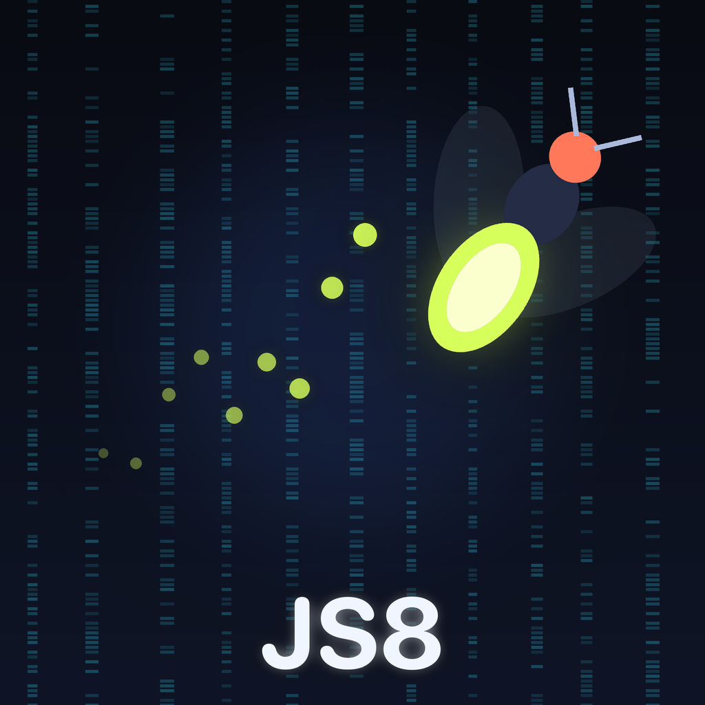

# JS8 Firefly

A native SwiftUI JS8 client for iPhone, iPad and Mac. It speaks the same JS8
modem and message protocol as [JS8Call](https://github.com/js8call/js8call) /
[JS8Call-improved](https://github.com/JS8Call-improved/JS8Call-improved), so it
talks to any JS8Call station on all five speeds: Slow, Normal, Fast, Turbo and
Ultra.

<p align="center"></p>

## Features

- **Exact JS8 compatibility**: 8-FSK modem, Costas sync, LDPC (174,87) with
  CRC-12, varicode/JSC message packing, heartbeat, compound and directed frames.
  Verified against a reference harness built from the original JS8Call source
  (see [Testing](#testing)).
- **Full JS8Call messaging**: band and call activity, directed queries (SNR?,
  GRID?, INFO?, STATUS?, HEARING?, QUERY MSGS, QUERY CALL, AGN?), auto-replies,
  heartbeats with acknowledgements, CQ, relays (`>`), inbox and store-and-forward
  (`MSG`, `MSG TO:`), groups and compound callsigns.
- **Decodes all speeds at once**, with a live waterfall (tap to set your offset)
  and decode labels.
- **Digirig support over USB-C**: Digirig Lite *PTT tone* (JS8 audio on the
  left channel, keying tone on the right) or VOX on both channels.
- **Rig control** with presets for QRP Labs QMX/QDX, Yaesu (FTDX3000, FT-991,
  FTDX101/10, FT-710, FT-891, …), Kenwood, Elecraft, Icom and Xiegu:
  frequency follows the app and the app follows the VFO, plus CAT PTT.
  - **Mac**: USB serial CAT, and RTS/DTR PTT (e.g. Digirig Mobile).
  - **iPhone/iPad**: iOS does not allow apps to open USB serial ports, so CAT
    runs over a Bluetooth LE serial adapter (Nordic UART / HM-10 style) or the
    network (Hamlib `rigctld`, flrig, or a raw serial-over-TCP bridge).
- Background receive, notifications for directed messages, clock-offset sync
  from received signals.

## Project layout

| Path | What it is |
|---|---|
| `JS8Core/` | Swift package: modem (FFT, encoder, decoder, modulator), protocol (Varicode, JSC, DecodedText) and the station engine. Platform independent and unit tested. |
| `JS8Call/` | The SwiftUI app (iOS 17+, macOS 14+): audio I/O, PTT, rig control, UI. |
| `JS8Call.xcodeproj` | Xcode project (single multiplatform target "JS8 Firefly"). |
| `tools/refharness/` | C++ harness built from the original JS8Call sources, used to cross-check the Swift port. |
| `Branding/` | Name and icon explorations. |

## Building

Open `JS8Call.xcodeproj` in Xcode and run the **JS8Call** scheme on an iPhone,
iPad or "My Mac". To run on your own device, set your team under
*Signing & Capabilities*.

## Testing

```bash
cd JS8Core && swift test -c release
```

The cross-check tests run the Swift implementation and the original JS8Call
code on the same inputs (encoding, frame building, decoded text, and audio
decoding of noisy signals). They are skipped unless the reference harness is
built:

```bash
git clone https://github.com/js8call/js8call.git reference/js8call
cmake -S tools/refharness -B tools/refharness/build && cmake --build tools/refharness/build
```

(The harness needs Qt 5 Core, Boost and FFTW, e.g. from Homebrew.)

## Hardware notes

- **Digirig Lite**: plug into the iPhone's USB-C port; choose *Digirig Lite –
  PTT tone* in Settings › Audio & PTT. Set TX level so the radio's ALC barely
  moves.
- **QMX/QDX** direct over USB audio: use *VOX* PTT.
- **FTDX3000**: audio through a Digirig on the rear DATA jack; CAT over its USB
  port (Mac) or a BLE/network bridge (iPhone).

## License

GPL-3.0. JS8 Firefly is a derivative of JS8Call (© Jordan Sherer, KN4CRD, and
contributors), itself derived from WSJT-X. It is not affiliated with or endorsed
by the JS8Call or WSJT-X projects. See [LICENSE](LICENSE).
